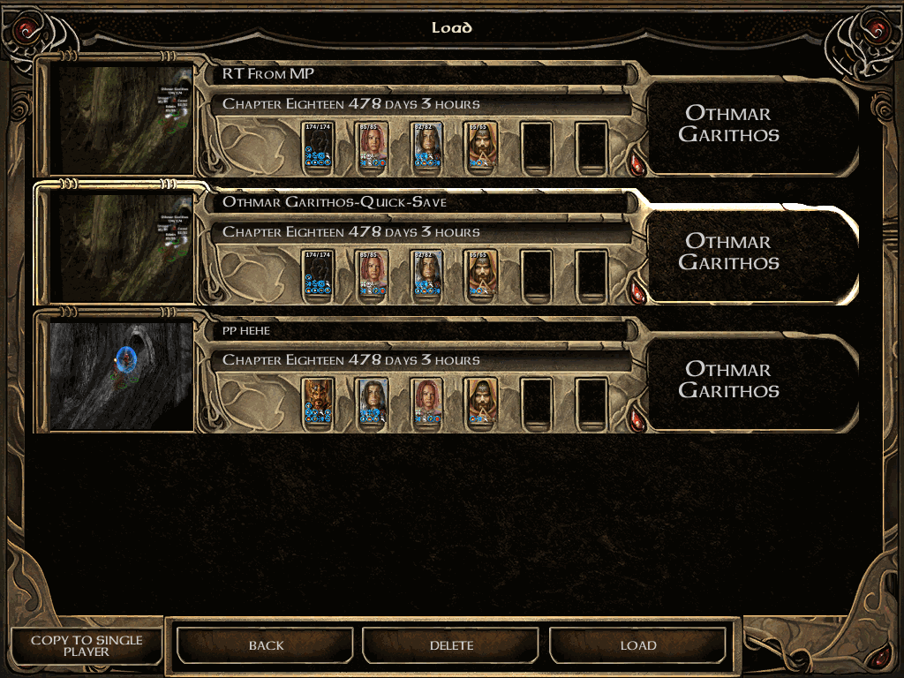
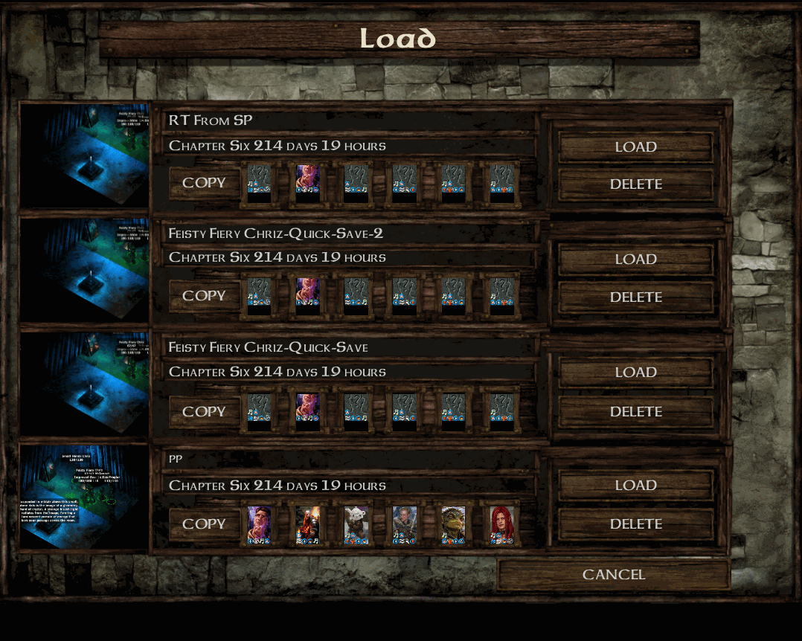

# Chriz Multiplayer Fix

Two EEex fixes for multiplayer in **BG:EE (incl. SoD)**, **BG2:EE**, **EET**, and **IWD:EE**:

1. **Lobby crash fix** — stops random crashes when leaving Beamdog's multiplayer lobby
   (especially *Multiplayer > Local network game > Load*).
2. **Copy saves between multiplayer and single player** — adds a one-click **Copy** /
   **Copy to single player** / **Copy to multiplayer** button right on the Load screen,
   keeping the original save untouched.

Part of **[Chriz Easy BG](https://bg.chrizfader.org/collection)** &
**[Chriz Easy IWD](https://bg.chrizfader.org/iwd)**

---

## Part 1: For Players

Together, these let friends or stream viewers create a custom party in multiplayer, move the
save straight into single player (and back again whenever you want) without copying folders by
hand.

### Moving a Party Between Multiplayer and Single Player

1. Host a game via **Multiplayer > Local network game > Load** (or **New Game**), create or
   import characters, and save.
2. On the multiplayer **Load** screen, copy the save:
   - **IWD:EE:** click **Copy** in the save's row.
   - **BG:EE, BG2:EE, EET:** select the save, then click **Copy to single player** at the
     bottom left.
3. Confirm the prompt — the game creates the copy in **Single Player > Load Game** using the
   next free save slot (nothing is ever overwritten).
4. Load the copy in single player and play on. To return to multiplayer later, repeat from
   **Single Player > Load Game** with **Copy to multiplayer**.

### Requirements & Installation

- Windows x64 **BG:EE (including SoD), BG2:EE, EET, or IWD:EE 2.7.3.0** with
  [EEex](https://github.com/Bubb13/EEex) **v1.2.0 or v1.3.1** (LuaJIT enabled, EEex's default,
  is required for the save copy button).

1. Close the game and install EEex first.
2. Copy the `chriz_multiplayer_fix` folder into your game directory.
3. Copy Windows x64 `weidu.exe` from [WeiDU](https://github.com/WeiDUorg/weidu/releases) into
   the game directory as `setup-chriz_multiplayer_fix.exe`.
4. Run `setup-chriz_multiplayer_fix.exe`, install components **0** and **1**, and launch via
   `InfinityLoader.exe`. Re-run to reinstall or uninstall cleanly.

---

## Part 2: Technical Details, Support & License

### Why the Lobby Crashed & How the Fix Works

The multiplayer lobby's libjingle `XmppClient` and socket belong to a dedicated network thread
(`XmppThread`), but `XmppPump::WakeTasks` (and inlined `Task::Start` / `Task::Wake`) posted
lobby tasks to `Thread::Current()` — meaning opening or refreshing rooms made the main thread
run lobby tasks too. On leaving the lobby, `DPProviderJingle::Close` (main thread) and
`XmppThread::OnMessage` (`MSG_DISCONNECT`) tore down and freed the same `XmppClient`/socket
simultaneously, causing a double-free / heap corruption crash. Two small EEex hooks (`CZMP.db`
+ `M_CZMP.lua`) redirect every lobby task post back to the network thread.

### Fallback Behavior & Support Docs

- **Safe fallbacks:** If an executable's bytes differ from the verified `2.7.3.0` signatures,
  the crash fix stays inactive and the game runs unmodified. If EEex is missing at install
  time, both components install as logged no-ops without aborting.
- **Documentation & tests:** [Support and verification details](docs/compatibility.md) ·
  [Changelog](CHANGELOG.md) · [Offline tests](tests/README.md)

## License

Licensed under the [MIT License](LICENSE).
